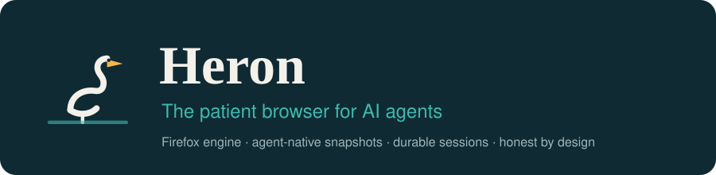

<p align="center"></p>

<p align="center"><b>Non-Chromium · Token-lean · MCP-ready · Cloudflare-gated · Honest by design</b></p>

Heron gives AI agents a real Firefox browser (WebDriver BiDi) and hands them the **complete page as compact text** instead of a screenshot or raw HTML. A metered, multi-tenant API and a Cloudflare gateway make it rentable; an MCP server plugs it into Claude.

## Why Heron
| | |
|---|---|
| **Whole page, few tokens** | Headings, lists, tables and text in reading order; clickable things inline as `⟨e12 button "Go"⟩`. A whole Wikipedia article is ~7k tokens. Long pages are paged by a token budget. |
| **Diff-aware** | After a click or keystroke on the same URL, only the changed lines come back. |
| **Non-Chromium** | Firefox/Gecko engine, driven over W3C WebDriver BiDi. |
| **Durable sessions** | Leases + heartbeats; one isolated browser profile per session. |
| **MCP + API** | Claude Code / Desktop tools, and a REST API behind a Cloudflare Worker (API-key auth, quotas, usage metering). |
| **Honest by design** | Truthful user agent, per-host politeness, bot challenges are reported to the user, never bypassed. |

## Quickstart (5 minutes, Windows or Linux)
```bash
git clone https://github.com/faizzyhon/heron-browser && cd heron-browser
cd heron && npm test        # needs Node 22+ and Firefox
npm start                   # API on http://127.0.0.1:8787  (default key: dev-key)
cd ../mcp && npm install    # then open this folder in Claude Code; .mcp.json registers the tools
```
Full walkthrough, Cloudflare deploy, API reference and troubleshooting: **[docs/SETUP.md](docs/SETUP.md)**. MCP details: [docs/MCP.md](docs/MCP.md).

## Layout
| Path | What |
|---|---|
| `heron/` | Origin server + Firefox driver + page reader (Node, zero dependencies) |
| `mcp/` | MCP server (stdio and HTTP) for Claude |
| `worker/` | Cloudflare Worker gateway (auth, tenants, proxy) |
| `docs/` | Setup guide, MCP guide |
| `research/` | Research synthesis and build plan |
| `assets/` | Logo and banner |

## Scope and principles
Heron declares itself and respects sites. It does **not** spoof fingerprints, imitate human input, or solve CAPTCHAs/Turnstile. When a site presents a challenge the page header reports `challenge_required` so a human or the customer's own approved flow can handle it. You are responsible for complying with the terms of the sites you automate.

## Roadmap
1. robots.txt respect (per-host rate gap exists)
2. Web Bot Auth request signing (Cloudflare signed agents)
3. Challenge handoff queue (pause/resume)
4. SSE streaming, checkpoints, iframe support
5. Docker image, Hostinger VPS deploy
6. Hashed key storage + Stripe usage billing, OAuth for the claude.ai connector
7. Optional custom Rust engine ([research/02-build-plan.md](research/02-build-plan.md))
